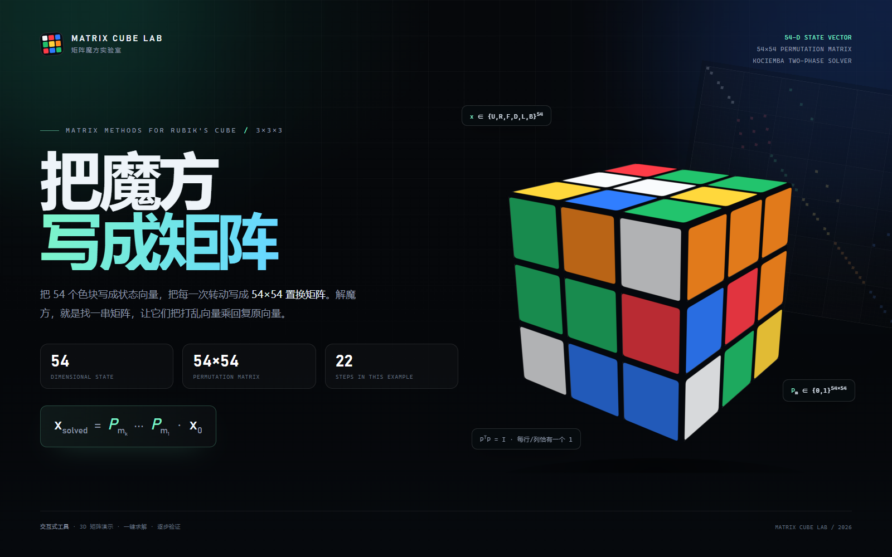
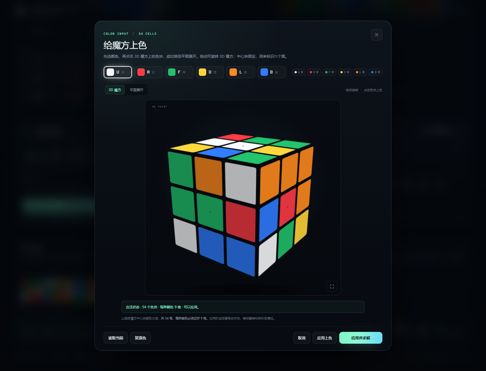
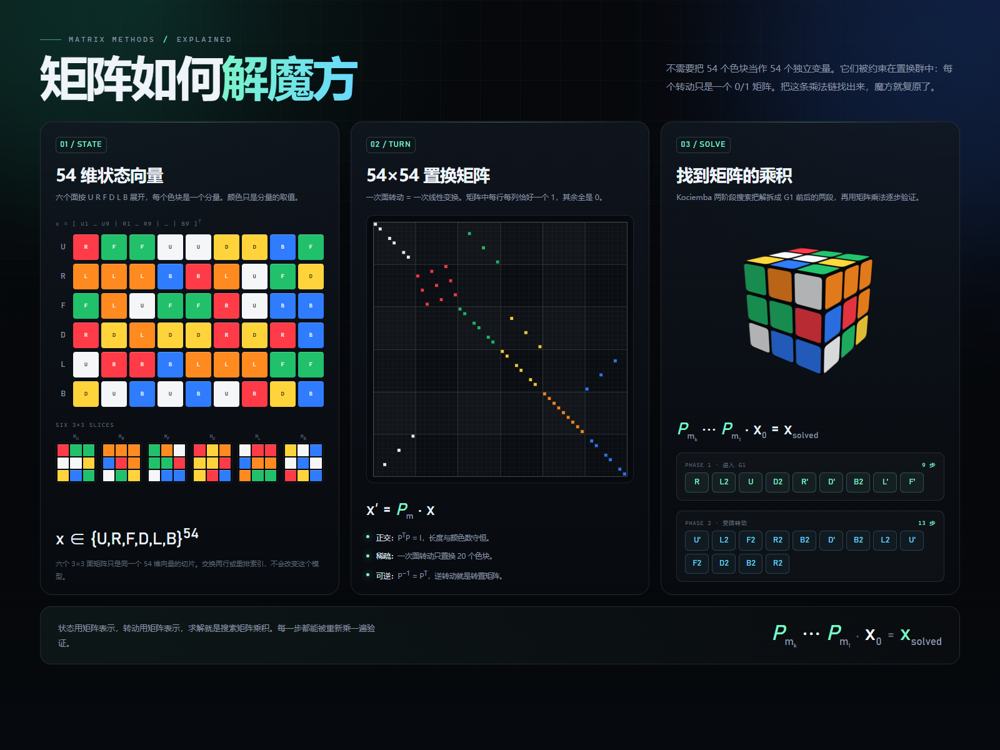
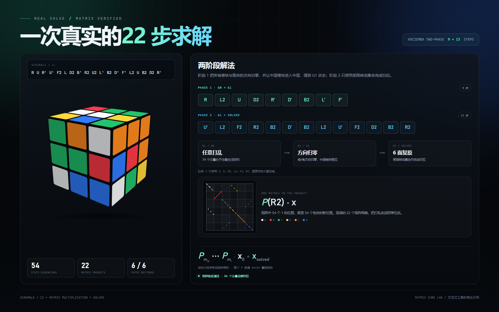
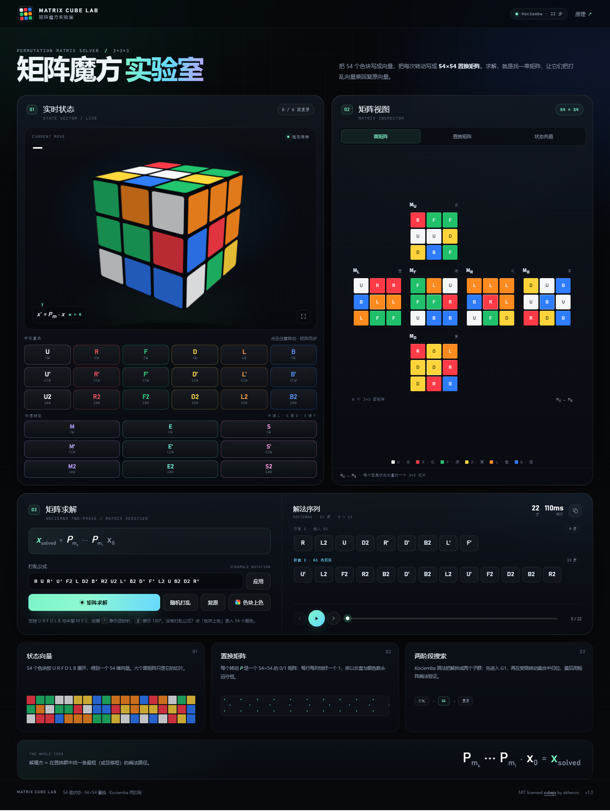

# 矩阵魔方实验室 · Matrix Cube Lab

一个把 3×3×3 魔方写成**矩阵**的交互式工具：54 维状态向量、54×54 置换矩阵、Kociemba 两阶段求解、可播放的 3D 转动、M/E/S 中层转动，以及没有打乱公式时使用的 **2D / 3D 色块上色输入**。



## 快速开始

**方式一：直接打开（推荐）**

双击 `index.html`。这是一个约 162 KB 的**完全自包含**页面，不依赖服务器、网络或第三方 CDN。求解器在浏览器的 Web Worker 中初始化（约 4–6 秒构建剪枝表）。

**方式二：本地服务器**

```bash
python -m http.server 8765
# 打开 http://127.0.0.1:8765/
```

**操作**

- 拖动 3D 魔方旋转视角，滚轮缩放，双击复位。
- 点击 `U / R / F / D / L / B` 及其 `'`、`2` 变体手动转动；矩阵视图会实时同步。
- 点击「中层转动」中的 `M / E / S` 及其 `'`、`2` 变体，执行中层切片转动。
- 在输入框输入标准 Singmaster 记号（如 `R U R' U' F2 M E S`），点击「应用」。
- 没有打乱公式？点击「色块上色」：默认在 3D 魔方上拖动旋转、点击色块上色，也可以切换到平面展开录入。
- 点击「矩阵求解」：生成通过矩阵乘法验证的解法。
- 「播放解法」会逐步转动；可暂停、拖动进度条、点击任意一步跳转。
- 键盘：`空格` 播放/暂停，`←/→` 上一步/下一步；上色弹窗中按 `Esc` 关闭。

## M / E / S 中层转动

除了六个面的转动，工具还支持标准中层切片记号：

| 记号 | 位置 | 方向 |
| --- | --- | --- |
| `M` | L 与 R 之间的中层 | 跟随 L |
| `E` | U 与 D 之间的赤道层 | 跟随 D |
| `S` | F 与 B 之间的站立层 | 跟随 F |

- 支持 `M2` / `M'` 等九种写法，输入框、按钮和矩阵选择器都能识别。
- 中层转动会移动 **4 个中心块 + 8 个棱块**，所以会改变中心块朝向；在 54×54 矩阵中对应 12 个分量的置换。
- 求解器仍然输出普通面转动序列；对于中心块已被中层转动旋转的状态，工具不再显示基于固定坐标系的「阶段 1 / 阶段 2」标签，而是显示一条完整解序列。
- 3D / 2D 上色面板打开时会自动把魔方旋转到标准中心朝向，再进入上色状态；取消上色不会改动主魔方。

## 色块上色（2D / 3D，无公式输入）

在「矩阵求解」区域点击 **色块上色**，会打开一个 54 格编辑面板：

1. 默认是 **3D 魔方**视图：按住拖动旋转视角，点击可见色块直接上色；
2. 也可以切换到 **平面展开** 视图，一次看到 U/L/F/R/B/D 六个面，点击或拖动连续上色；
3. 先点选六种颜色中的一种（U 白 / R 红 / F 绿 / D 黄 / L 橙 / B 蓝）；
4. 六个中心块固定，不能修改；3D 视图中中心块有一个小圆点标记；
5. 顶部实时显示每种颜色的数量，必须每种正好 9 格；
6. 点击「应用上色」只更新状态；点击「应用并求解」会立即搜索解法。

3D 视图默认只显示朝向镜头的三个面；转动魔方即可给隐藏面继续上色。两种视图共享同一份 54 格状态，切换不会丢失修改。

应用前会检查状态的合法性：

- 每种颜色 9 格；
- 角块扭转和是 3 的倍数；
- 棱块翻转和是偶数；
- 角块与棱块的排列奇偶性一致。

不满足条件时（例如拆开重装、硬扭角、硬翻棱造成的状态），按钮会禁用并显示具体原因，避免把无解状态送进求解器。



## 图片

| 图片 | 内容 |
| --- | --- |
|  | 1600×1000 封面：54 维状态、54×54 矩阵与 3D 魔方 |
|  | 1600×1200 图解：状态向量 → 置换矩阵 → 两阶段求解 |
|  | 1600×1000 实例：22 步解法的两阶段矩阵乘积 |
|  | 1440×1100 3D 上色面板：拖动旋转、点击色块、颜色选择与合法性检查 |
|  | 1440×1913 工具界面预览（含 M/E/S 中层转动） |

## 矩阵模型

### 1. 54 维状态向量

六个面按 `U R F D L B` 展开，每个面按阅读顺序展开成 9 个分量：

```text
x = [ U1 … U9 | R1 … R9 | F1 … F9 | D1 … D9 | L1 … L9 | B1 … B9 ]ᵀ
```

每个分量的取值是它当前的颜色（`U/R/F/D/L/B`）。六个 `3×3` 面矩阵只是这个向量的切片。

### 2. 转动 = 置换矩阵

每个基本转动（`U`、`R`、`F`、`D`、`L`、`B`，以及 `'`、`2`）对应一个 54×54 的 0/1 矩阵 `P`：

- 每行每列恰好一个 `1`，其余为 `0`；
- `P` 是正交矩阵：`PᵀP = I`，所以长度和颜色数量守恒；
- 逆转动就是 `Pᵀ`；
- 一次面转动只置换 20 个色块（面内 8 个 + 侧面 12 个），其余 34 个分量不动。

状态更新写成矩阵乘法：

```text
x′ = P_m · x
```

整条解法就是一串矩阵的乘积：

```text
x_solved = P_mk ⋯ P_m1 · x₀
```

工具中的 54×54 矩阵视图、逐格色块变化、解法验证全部来自这个模型。

### 3. 两阶段求解

求解器使用 Herbert Kociemba 的两阶段算法：

1. **Phase 1**：把棱块/角块方向归零，并让中层棱块进入中层，得到一个 **G1** 状态；
2. **Phase 2**：只使用受限转动集合 `U, D, R2, L2, F2, B2` 完成归位。

工具会在结果中检测 G1 边界，把解法标成「阶段 1 / 阶段 2」。搜索只负责找转动序列；找到后，每一步都会通过置换矩阵重新乘一遍，最终检查 6 个面是否全部复原。**搜索与验证是两条独立路径。**

## 文件结构

```text
rubik-matrix-lab/
├─ index.html                  # 最终自包含工具（直接打开）
├─ build.mjs                   # 把 src + vendor 内联成 index.html
├─ src/
│  ├─ core.js                  # 54 维状态、置换矩阵、转动、合法性校验
│  ├─ app.js                   # 3D Canvas 渲染、UI、求解 worker 桥接
│  ├─ style.css                # 页面样式
│  ├─ template.html            # HTML 模板
│  └─ worker-tail.js           # Worker：Kociemba + G1 边界检测
├─ js/vendor/cubejs.bundle.js  # MIT cubejs 的浏览器 bundle（仅求解器用）
├─ art/                        # 生成图片的 HTML 源
├─ assets/                     # 最终 PNG 图片
├─ start.bat                   # Windows 一键打开
├─ THIRD_PARTY_LICENSES.md
└─ LICENSE
```

## 构建

```bash
node build.mjs
```

`build.mjs` 读取 `src/`、`js/vendor/cubejs.bundle.js`，将 CSS/JS/Worker 源内联到 `index.html`。不需要安装任何 npm 依赖即可构建。

如果要重新生成 `js/vendor/cubejs.bundle.js`：

```bash
npm install
npx esbuild node_modules/cubejs/index.js --bundle --format=iife \
  --global-name=CubeJS --minify --outfile=js/vendor/cubejs.bundle.js
```

重新生成图片需要 Playwright + Chrome：

```bash
# 页面是 art/*.html；用浏览器以 1600 宽度打开后截图即可
```

## 已验证

- 27 个基本转动（18 个面转动 + 9 个 M/E/S 切片转动）与参考实现逐面比对一致。
- Node 端 40 组随机 20 步打乱，求解结果全部被 54 维矩阵校验为复原。
- 含 `M/E/S` 的混合打乱（包括只含中层转动的状态）可被求解器复原。
- 浏览器端完整流程：自动求解 → 播放 22 步 → 6/6 面复原；暂停/继续、随机打乱、输入打乱、复位均正常。
- 色块上色：3D 点击上色、3D 拖动旋转且不误涂、2D/3D 视图切换、54 格编辑、颜色计数、拖动上色、合法性检查、应用上色、应用并求解均已验证。
- 非法状态（单角扭转、单棱翻转、两棱交换、两角交换）会被合法性检查拒绝。
- `file://` 直接打开（无需服务器）和 `http://` 两种方式均可启动 Worker 求解。

## 已知限制

- 只支持 3×3×3 魔方；支持面转动与 `M/E/S` 中层切片，不支持 `x/y/z` 整体旋转记号或 4×4。
- 求解器输出仍是普通面转动；如果状态被中层转动旋转了中心块，会显示一条完整解序列，不显示依赖固定中心坐标系的 G1 阶段标签。
- 求解表首次构建约 4–6 秒，取决于设备；这段在 Worker 中进行，主线程不会卡死。
- Kociemba 搜索保证给出可解序列，但不保证最短；默认上限 22 步。
- 3D 视图是 Canvas 2D 的画家算法，极少数擦边视角可能出现贴纸排序瑕疵；拖动/缩放可避开。
- 颜色采用标准配色：U 白、R 红、F 绿、D 黄、L 橙、B 蓝。上色面板以中心块颜色标识面，中心块固定；3D 视图一次只显示朝向镜头的三个面，需要拖动旋转给隐藏面上色。
- 上色面板只接受合法魔方状态；即使每种颜色正好 9 格，仍有约 11/12 的颜色排列不能由转动得到，会被拒绝而不是给出错误解法。

## 第三方

- 求解器：[cubejs](https://github.com/ldez/cubejs) by Petri Lehtinen / Ludovic Fernandez，MIT License。完整许可见 [THIRD_PARTY_LICENSES.md](THIRD_PARTY_LICENSES.md)。
- 本项目其余代码与图片：MIT License，见 [LICENSE](LICENSE)。
